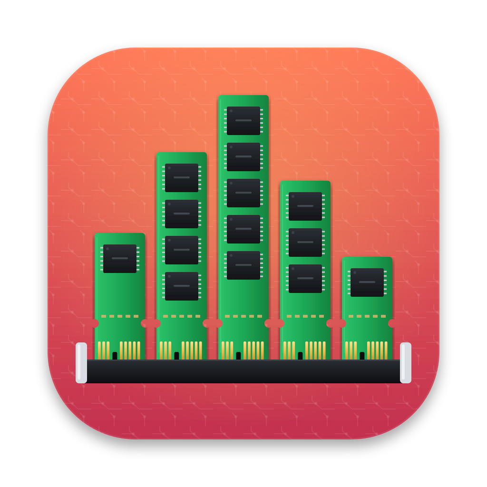
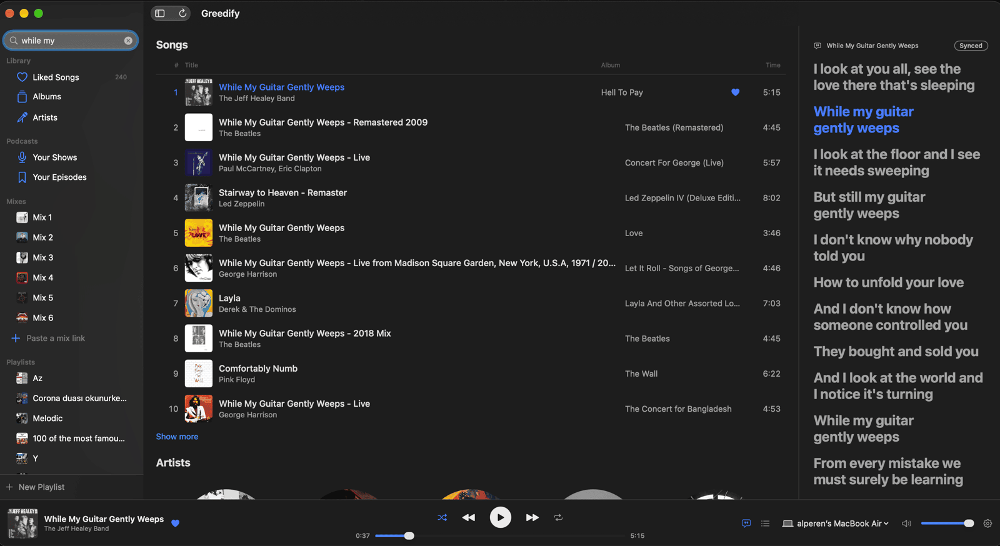
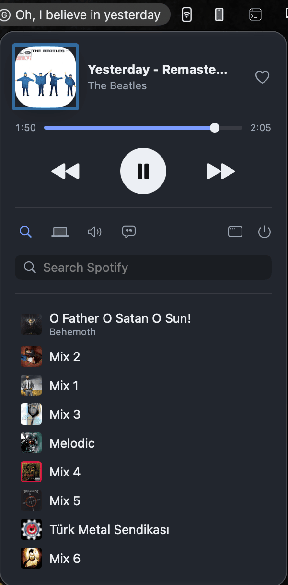
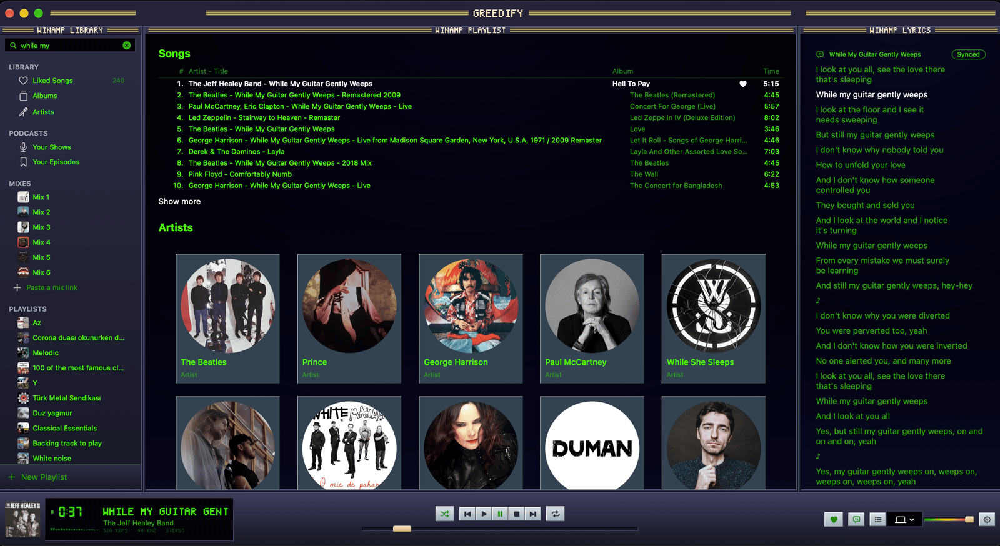
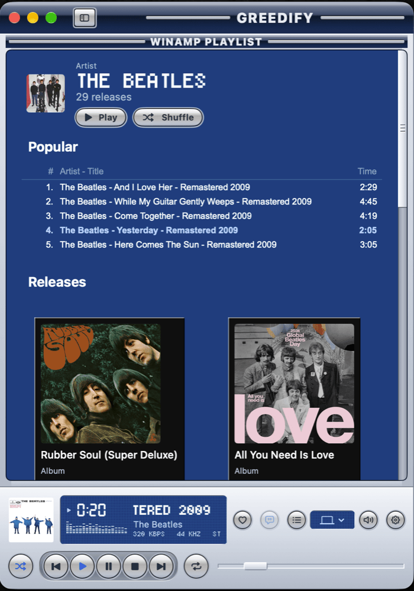

<p align="center">
  
</p>

<h1 align="center">Greedify</h1>

<p align="center">
  A small, native Spotify client for macOS that lives in your menu bar.<br>
  SwiftUI on top of the Spotify Web API, with audio from a bundled <a href="https://github.com/librespot-org/librespot">librespot</a>.
</p>

<p align="center">
  
  
  
</p>

<p align="center">
  
</p>

---

## Why

The official Spotify desktop app is built on the Chromium Embedded Framework and easily sits at hundreds of megabytes. Greedify does the everyday things (play, browse your library, search, lyrics) with a native UI and a footprint measured in tens of megabytes:

| State | Greedify |
|---|---|
| Menu bar only (fresh launch) | ~23 MB |
| Main window open | ~56–74 MB |
| After closing the window | ~50 MB |

librespot, which plays the audio, adds about 7 MB.

## Features

**Menu bar**
- Now playing with cover, seek bar and transport controls
- Search right in the popover: songs, artists, albums and playlists, one click to play
- Pin playlists, mixes and songs to the popover for one-click playback
- Optional synced lyrics line right in the menu bar

<p align="center">
  
</p>

**Main window**
- Liked Songs, albums, artists, playlists, Daily Mixes, podcasts and episodes
- Search across everything, artist pages with popular songs and releases
- Synced lyrics from [LRCLIB](https://lrclib.net), in a resizable side panel
- Adapts as you resize it: the lyrics fold away first, then the sidebar, and the player bar rearranges itself, all animated
- A refresh button picks up playlist edits made in other Spotify apps
- Context menus: add to queue, start song radio, add to playlist, go to album or artist

**Playback**
- The Mac itself is a Spotify Connect speaker (librespot runs as a child process and stops with the app)
- Switch playback between your devices
- Media keys, macOS Now Playing and Control Center integration
- AppleScript support using Spotify's own dictionary, so existing scripts and tools keep working
- Podcasts resume where you left off and play the next episode

**Themes**
- System look, a few plain themes, and curated skins: Winamp Classic and Winamp5 Classified

<p align="center">
  
  
</p>

## Download

Grab `Greedify-<version>.zip` from the [latest release](../../releases/latest). It runs on Apple silicon Macs with macOS 15 or later.

1. Unzip it and drag **Greedify** to your **Applications** folder. Run it from there, because the Spotify login comes back through a `greedify://` link that is tied to the app's location.
2. Greedify isn't notarized by Apple (that needs a paid developer account), so macOS blocks it the first time. Either open it once, then go to **System Settings → Privacy & Security** and click **Open Anyway**, or clear the download flag in Terminal:

```bash
xattr -dr com.apple.quarantine /Applications/Greedify.app
```

Then follow [Setting up](#setting-up). You still need your own Spotify developer app; it takes two minutes.

## Requirements

- macOS 15 or later
- A **Spotify Premium** account (the Web API only controls playback for Premium accounts)
- Your own **Spotify developer app** (free, takes two minutes, see below)
- To build: Xcode 27 (what it's developed with), [Homebrew](https://brew.sh), `librespot` and `xcodegen`

## Building

```bash
brew install librespot xcodegen
```

It builds signed ad-hoc out of the box. If you'll rebuild often, sign with your own Apple Development certificate instead: a stable identity keeps the Keychain and Accessibility permissions from resetting on every build. Copy `Local.xcconfig.example` to `Local.xcconfig` (git-ignored) and put your team ID in it; this lists your certificates and their team IDs:

```bash
security find-identity -v -p codesigning
```

```bash
scripts/install.sh
```

That builds a Release copy and installs it to `/Applications`. Always run the installed copy: the login item and the `greedify://` login callback are tied to its location.

## Setting up

Greedify talks to Spotify through **your own** developer app, so you never share credentials with anyone. The setup window walks you through it on first launch:

1. Create an app at [developer.spotify.com/dashboard](https://developer.spotify.com/dashboard):
   - Redirect URI: `greedify://callback`
   - API: Web API
   - Under **User Management**, add the email of your Spotify account
2. Paste the app's **Client ID** into Greedify and log in.
3. Connect the Mac as a speaker (your browser opens once for librespot's login).
4. Optionally allow Accessibility so the media keys control Spotify.

Spotify apps in development mode have per-endpoint daily quotas. Greedify caches aggressively and slows its polling when nothing plays, so normal use stays well inside them.

## Development

```bash
# Unit tests (all logic lives in the Swift package)
cd Packages/GreedifyKit && swift test
```

```bash
# Debug build (the Xcode project is generated from project.yml; never edit it by hand)
xcodegen generate && xcodebuild -project Greedify.xcodeproj -scheme Greedify -configuration Debug -derivedDataPath build build
```

```bash
# Memory: Greedify + librespot physical footprint
scripts/measure-memory.sh
```

```bash
# A release zip for GitHub Releases (ad-hoc signed, arm64): build/release/Greedify-<version>.zip
scripts/package.sh
```

The code is split in two:

- **`Packages/GreedifyKit`**: everything testable, covered by Swift Testing. The Web API client (PKCE, retry and rate-limit back-off), the observable stores, caches, lyrics, layout rules, the librespot process and the theme engine.
- **`App/`**: SwiftUI views and wiring only.

[`CLAUDE.md`](CLAUDE.md) is the detailed engineering notebook: architecture, the Spotify API's quirks, and the lessons that keep the memory and CPU numbers where they are. To add a skin, see [`docs/adding-a-skin.md`](docs/adding-a-skin.md).

## Credits

- [librespot](https://github.com/librespot-org/librespot) for the Spotify Connect speaker
- [LRCLIB](https://lrclib.net) for lyrics
- Skins: Winamp base skin 2.91 by Nullsoft; Winamp5 Classified by Sven Kistner, Zarko Jovic, GuidoD and Wildrose-Wally

## Disclaimer

Greedify is a personal, unofficial project. It is not affiliated with, endorsed by or connected to Spotify AB. Spotify is a trademark of Spotify AB.
